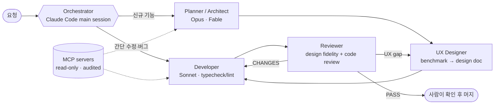

**AI 에이전트를 실제 업무 흐름에 넣는 사람.** 
웹 프론트엔드에서 출발해, 지금은 AX(AI Transformation) 팀에서 에이전트 하네스를 설계하고 운영합니다.

I build agent harnesses — subagents, skills, MCP servers and hooks — that let AI do real work inside a company, safely.

 

---

## 🧭 What I do

- **AX 팀 — 사내 업무를 AI 워크플로우로 전환**합니다. "챗봇 하나 붙이기"가 아니라, 에이전트가 실제 시스템을 읽고·만들고·검토하게 만드는 일입니다.
- **사내 데이터용 MCP 서버를 직접 구축**했습니다. Claude가 사내 ERP 데이터를 *읽기 전용*으로 조회하고, 모든 호출은 원문 질문과 함께 감사 로그로 남습니다.
- **사내 포털을 에이전트 팀으로 개발**합니다. 설계 에이전트가 외부 제품을 벤치마킹해 설계서를 쓰고, 개발 에이전트가 구현하고, 다시 설계 에이전트가 충실도를 검토합니다.
- **팀 지식을 자동으로 쌓습니다.** 머지된 PR을 훑어 결정·트러블슈팅·런북을 팀 위키 초안으로 정리하는 에이전트를 운영합니다.

---

## 🛠️ Agent Harness Engineering

> 모델은 엔진이고, 하네스는 차체입니다. 좋은 결과는 **역할·도구·가드레일**을 어떻게 짜느냐에서 나옵니다.
> 제 하네스는 **Claude Code** 위에 만들어져 있습니다.

| Layer | 구성 |
|---|---|
| **Subagents** | 프로젝트마다 역할을 나눈 커스텀 에이전트 20+ — `planner` · `ux-architect` · `architect` · `developer` · `reviewer` · `refactor` · `wiki-updater` 등. 코드를 쓰는 주체는 하나로 고정하고, 설계자는 코드를 쓰지 않습니다. |
| **Skills** | `/srm-dev` 설계→구현→충실도 검토 루프 오케스트레이션 · `/청소` 죽은 코드 전수 분석 후 삭제(UI는 1px도 변경 금지) · `/a2a` 에이전트 간 핸드오프 프로토콜 · `/update-team-wiki` · `/jira-md` · `/claude-hud-install` |
| **MCP** | 직접 만든 사내 데이터 MCP(읽기 전용 SQL + 큐레이션된 지식베이스 + 감사 로그) · Slack · Microsoft 365 · Google Drive · Vercel |
| **Hooks & HUD** | SessionStart 훅으로 브랜치·미커밋·열린 PR을 컨텍스트에 주입 · [claude-hud](https://github.com/jarrodwatts/claude-hud) 상태줄로 컨텍스트/툴/에이전트 실시간 표시 |
| **Memory** | 프로젝트별 결정·피드백을 메모리로 기록해 같은 실수를 반복하지 않게 합니다. |
| **Model routing** | 판단·설계는 Opus / Fable, 대량 구현은 Sonnet. 작업 크기에 따라 단계를 건너뜁니다. |
| **Process** | 큰 기능은 AI-DLC(Inception → Construction) 단계로, 산출물은 파일로 남겨 에이전트 간 컨텍스트 손실을 막습니다. |

**Guardrails I care about**

- 🔒 **Least privilege** — DB는 SELECT 전용, 시스템 스키마 차단, 추측한 테이블명은 거부
- 🧾 **Audit by default** — 에이전트의 모든 데이터 호출에 사용자 원문 질문을 함께 기록
- 🤝 **Human in the loop** — 에이전트는 커밋·푸시하지 않고, 설계 승인과 머지는 사람이 합니다
- ⚡ **Lean verification** — 타입체크·린트까지만 자동으로, 화면 확인은 사람이 직접

---

## 📦 Featured Projects

<table>
<tr>
<td width="50%" valign="top">

### [Duru](https://github.com/git-Harrison/Duru)
Markdown · JSON · YAML · 텍스트를 **두루** 보고 고치는 가벼운 Windows 앱.
목차·다크모드·여러 문서 탭·실시간 리로드, 5개 언어 UI(en/ko/ja/zh/es).

오픈소스(MIT) · GitHub Actions 빌드 · winget 등록 및 코드 서명 진행 중

</td>
<td width="50%" valign="top">

### [KidsNote Downloader](https://github.com/git-Harrison/kids-note-downloader)
키즈노트 알림장·앨범의 사진/동영상을 **원본 그대로** PC에 백업하는 개인용 Windows 앱(비공식).
공식 로그인 화면으로 로그인, 비밀번호 미저장, 이어받기와 날짜별 정리.

Node.js CLI → 설치형 Windows 앱으로 재작성

</td>
</tr>
</table>

**Building now** (private · 모두 에이전트 팀으로 개발 중)

| Project | What | How it's built |
|---|---|---|
| 🏰 **Multi-tenant Guild SaaS** | 게임 길드 운영 플랫폼, 단일 도메인 멀티테넌트 + 3단계 RBAC | Next.js 16 · Supabase(RLS) · Vercel — planner → designer → architect → builder → reviewer, AI-DLC |
| 🕵️ **Pixel Mafia** | 서비스 종료된 모바일 마피아 게임을 계승하는 1인 개발 게임 | PM 에이전트 + 파트별 사수/부사수 에이전트의 A2A 리뷰 |
| 🏎️ **Mini 4WD Dex** | 미니카·RC 도감 웹앱 | Next.js · 토큰 기반 디자인 시스템 · `/a2a` 설계→화면설계→구현→검증 |

<b>Earlier work</b>

- [mancity](https://github.com/git-Harrison/mancity) — React + TypeScript 기반 맨시티 팬 허브 (뉴스·영상·경기 기록·포메이션 메이커)

---

## 🧰 Tech Stack

**AI / Agents** 

**Frontend** 

**Backend / Data** 

**Desktop / DevOps** 

---

Issues and feedback are always welcome · 이슈나 피드백은 언제든 환영합니다

